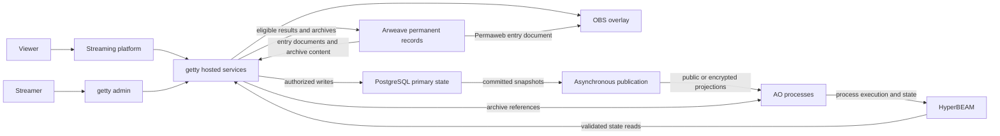

# Architecture

**Status:** Concept · **Audience:** Developers and researchers

Getty connects live creator tools with versioned AO projections and permanent Arweave records. The production integration described here uses PostgreSQL as the primary application store and a getty-operated HyperBEAM node for AO execution and state inspection. Feature availability still depends on the deployment.

## Responsibilities

- **Getty admin** manages user-authorized configuration and actions.
- **Hosted services** authenticate actions, coordinate writes, deliver WebSocket updates, and expose supported read models.
- **PostgreSQL** confirms the current application state. A committed vote or draw and publication of its AO projection are separate steps.
- **Asynchronous publication** submits versioned projections of committed state. A publication retry repeats the projection, not the vote or draw.
- **OBS overlays** render the supported getty presentation state without receiving private signing material.
- **AO** holds the public projections, selected encrypted copies, and lightweight archive references used by this integration.
- **HyperBEAM** evaluates AO process messages and exposes selected state through HTTP. Getty operates its own node; deployment topology and administration remain outside this public reference.
- **Arweave** stores immutable assets, selected result records, and verified stream archives. Stream History uses bounded Turbo-free objects; oversized media follows the [account policy](ao-arweave-hyperbeam.md#native-ar-policy-for-permanent-media).

For the role of each module, see [AO, Arweave, and HyperBEAM](ao-arweave-hyperbeam.md). For the evidence needed to confirm publication, see [Publication and verification](publication-and-verification.md).

## Workspace and storage boundaries

A workspace owns its configurations and history independently of the provider used to sign in. Verified access identities, chat/notification connections, and selected Stream History sources have separate purposes; see [Accounts and sign-in](accounts-and-sign-in.md).

Primary application state, historical observations, coordination/cache state, AO projections, and permanent archives are distinct data responsibilities. A cache, a matching channel, or a public process identifier does not establish ownership of another workspace.

Selected settings and achievement records can have encrypted AO copies. This is not a complete public export of account configuration: authentication records, credentials, wallet keys, and private identity mappings are excluded from that publication scope. Permanently stored ciphertext still requires protection of its original decryption material.

## Trust and availability

Public widget tokens and URLs are designed for presentation and read access. They are not administrative credentials. Process ownership, application signing, and tenant storage authorization remain separate roles.

A namespaced permanent upload uses the wallet configured for that data owner. Missing or unavailable tenant wallet configuration fails closed instead of falling back to a server wallet. Native AR authorization applies only to the current tenant and the approved media operation.

An AO publication can lag behind a confirmed primary change. A durable process or transaction identifier also does not guarantee that every node or gateway can currently serve it. Availability, publication status, and content verification must be evaluated separately.

---

[Documentation index](index.md) · [Next: Overlays and OBS](overlays.md)
